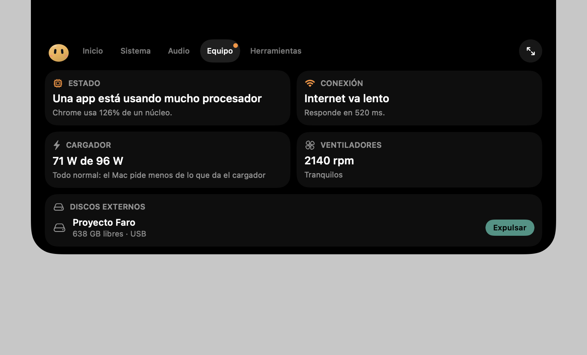
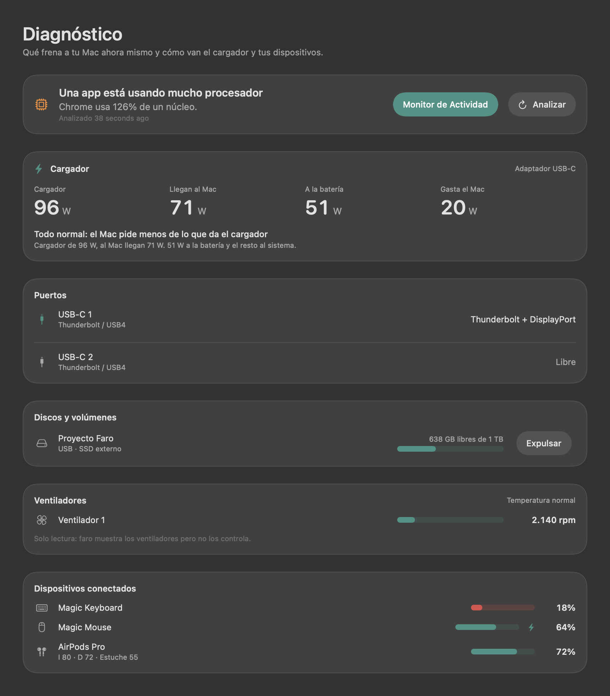

<div align="center">


# Faro

**Your Mac, explained and under control.**

A native, local-first macOS control center for the menu bar and notch. Faro combines diagnostics, automation, storage, audio, widgets and small everyday tools without accounts or telemetry.

[Website](https://faro.conectalab.co/en/) · [Download](https://faro.conectalab.co/en/download) · [Updates](https://faro.conectalab.co/en/updates) · [Press kit](https://faro.conectalab.co/en/press) · [Report an issue](https://github.com/dpulr/faro/issues)

[](https://github.com/dpulr/faro/actions/workflows/ci.yml)
[](https://github.com/dpulr/faro/releases/latest)
[](https://github.com/dpulr/faro/releases)
[](LICENSE)


**[Leer en español](README.md)**



</div>

## Why Faro

- **Understand what is slowing down your Mac.** CPU, memory, disk, temperature and power findings point to the responsible app and the right action.
- **Turn the notch into useful space.** Music, lyrics, controls, weather, calendar, storage, connection status and tools live in a configurable matrix.
- **Make the Mac adapt to context.** Scenes can react to the foreground app, meetings, full screen, Bluetooth, displays, battery or schedules.
- **Recover storage safely.** Recommendations distinguish safe cleanup from files that need review and forecast when the disk may fill.
- **See connected equipment.** Charger power, USB-C transports, external drives, fans and peripheral batteries appear in one place.
- **Keep data local.** There are no Faro accounts, analytics or telemetry. Every optional connection is documented.

## Highlights

| Area | What it does |
|---|---|
| Diagnostics | Explains bottlenecks and opens the relevant system action |
| Notch | Resizable widgets, presets, floating island and contextual notices |
| Scenes | Automates the visual layout and system controls, then restores them |
| Storage | Safe cleanup, forgotten large files and fill forecast |
| Audio | System output plus independent controls for Music and Spotify |
| Productivity | Clipboard history, file shelf, Pomodoro, emoji viewer and command center |
| Appearance | Wallpaper channels, mixed sources, custom colors and mascot |

<p align="center">
  
</p>

## Install

Download the signed and Apple-notarized DMG from the [latest release](https://github.com/dpulr/faro/releases/latest) or from the [official download page](https://faro.conectalab.co/en/download). Open it, drag Faro to Applications and launch it.

Requirements:

- macOS 14 Sonoma or later.
- Apple Silicon or Intel Mac.
- On displays without a notch, Faro uses a compact floating island.

## Build from source

Xcode 26 or later and Swift 5.9 or later are required.

```bash
git clone https://github.com/dpulr/faro.git
cd faro
./scripts/build-app.sh
```

The script creates and installs `faro.app`. Distribution builds, signing and notarization are documented in [docs/DISTRIBUCION.md](docs/DISTRIBUCION.md).

## Privacy and permissions

Faro asks only for the permission needed by the feature you choose. Accessibility, Automation, Calendars, Bluetooth, Notifications and folder access are optional; refusing one leaves the rest of the app available.

The complete data-flow table is available in the [privacy policy](https://faro.conectalab.co/en/privacy) and in the Spanish [project documentation](README.md#permisos-y-privacidad).

## Project documentation

- [Architecture](docs/ARQUITECTURA.md)
- [Changelog](CHANGELOG.md)
- [Contributing](CONTRIBUTING.md)
- [Security policy](SECURITY.md)
- [Code of conduct](CODE_OF_CONDUCT.md)
- [Press kit](docs/PRESS_KIT.md)

## Contributing

Bug reports, focused pull requests and well-scoped ideas are welcome. Read [CONTRIBUTING.md](CONTRIBUTING.md) before opening a change. Please report vulnerabilities privately using [SECURITY.md](SECURITY.md).

## License

Faro is free software under the [GNU Affero General Public License v3 or later](LICENSE). Copyright © 2026 Conecta Lab Corp.

