<div align="center">


# faro

**Lo útil de tu Mac, en un solo lugar de la barra de menú.**
Fondos que cambian solos, el estado del sistema, historial del portapapeles, una bandeja de archivos, un panel en el notch y más. Todo local, sin cuentas y sin servidores.

[](LICENSE)


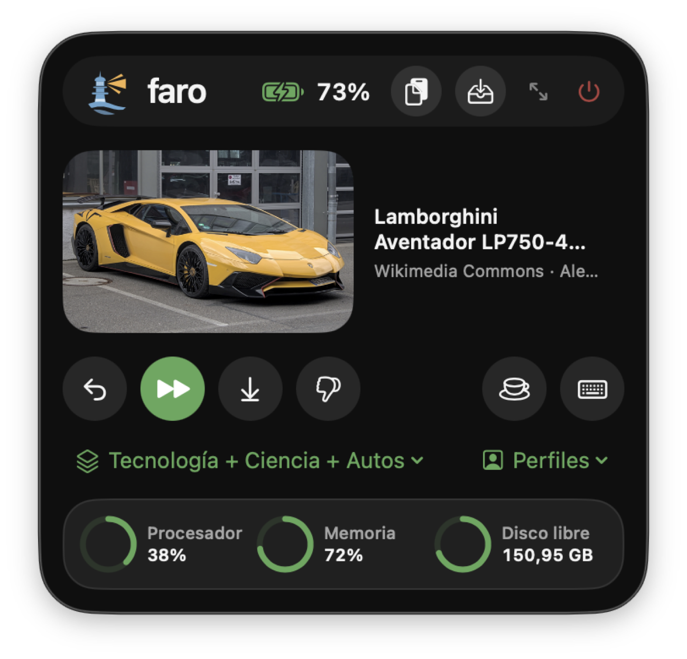

</div>

> **English in one line:** *faro* is a free, local-first macOS menu-bar suite (wallpaper channels, system monitor, clipboard history, file shelf, notch panel, keyboard-cleaning lock and profiles) written in SwiftUI. The interface comes in Spanish and English (it follows your system language, or pick one in *General*).

---

## Contenido

- [¿Qué es faro?](#qué-es-faro)
- [Funciones](#funciones)
- [Requisitos](#requisitos)
- [Instalación](#instalación)
- [Atajos de teclado](#atajos-de-teclado)
- [Permisos y privacidad](#permisos-y-privacidad)
- [Fuentes de fotos y atribuciones](#fuentes-de-fotos-y-atribuciones)
- [Dónde guarda cada cosa](#dónde-guarda-cada-cosa)
- [Desarrollo](#desarrollo)
- [Preguntas frecuentes](#preguntas-frecuentes)
- [Hoja de ruta](#hoja-de-ruta)
- [Contribuir, seguridad y conducta](#contribuir-seguridad-y-conducta)
- [Licencia](#licencia)
- [Agradecimientos](#agradecimientos)

---

## ¿Qué es faro?

faro nació para reemplazar una app de pago que solo cambiaba el fondo de pantalla, y creció hasta reunir las pequeñas utilidades que suelen repartirse entre diez apps distintas. Vive en la barra de menú, no ocupa el Dock y se maneja con botones redondos que explican lo que hacen apenas pasas el cursor.

Principios con los que está hecho:

- **Local primero.** Tus datos viven en tu Mac. No hay cuentas, ni telemetría, ni servidor propio.
- **Minimalista y en lenguaje llano.** Pocas cosas en pantalla y textos que cualquiera entiende, en español o en inglés.
- **Sin pagos ni claves de API.** Las fuentes de fotos, el clima y la medición de internet funcionan sin registrarse en nada.
- **Respeta tu disco.** Solo guarda la foto actual de cada monitor; todo lo demás se descarga y se borra.
- **Diseño propio.** Cristal líquido en macOS 26, un logo de faro dibujado a mano (disponible en [SVG](docs/images/logo.svg)) y controles propios en lugar de los genéricos del sistema.

## Funciones

### Fondos de pantalla con canales mezclados

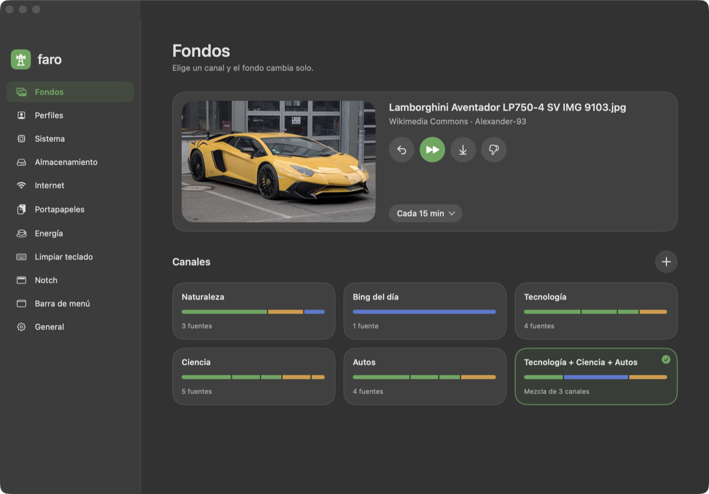

Un **canal** es un tema; una **mezcla** reparte las fotos entre varios canales. Un clic activa un canal; el lápiz (al pasar el cursor) lo edita.

- **Siete fuentes sin clave:** [Wallhaven](https://wallhaven.cc) (solo contenido seguro), [Wikimedia Commons](https://commons.wikimedia.org) (solo fotos destacadas), el archivo de [Bing](https://www.bing.com) en UHD, el [Art Institute of Chicago](https://www.artic.edu) (obras de dominio público), las [imágenes de la NASA](https://images.nasa.gov), [Picsum](https://picsum.photos) (fotos al azar) y **carpetas locales**.
- **Mezcla por niveles:** cada fuente o canal pesa *Poco*, *Normal* o *Mucho*. El sorteo respeta esos pesos de verdad.
- **Canales de fábrica:** Naturaleza, Bing del día, Tecnología, Ciencia, Autos, una mezcla de los tres últimos, Arte, Espacio y Al azar.
- **Filtros:** resolución mínima respecto a tu pantalla (flexible, alta o exacta), solo fotos horizontales, sin repetir las últimas 50 y una lista de fotos **ocultas para siempre**.
- **Control total:** volver a la foto anterior, guardar la actual en `Imágenes/faro`, marcar *No me gusta* y un fondo distinto por monitor.
- **Intervalo:** cada 15 o 30 minutos, 1, 2 o 6 horas, 1 día, o solo a mano.

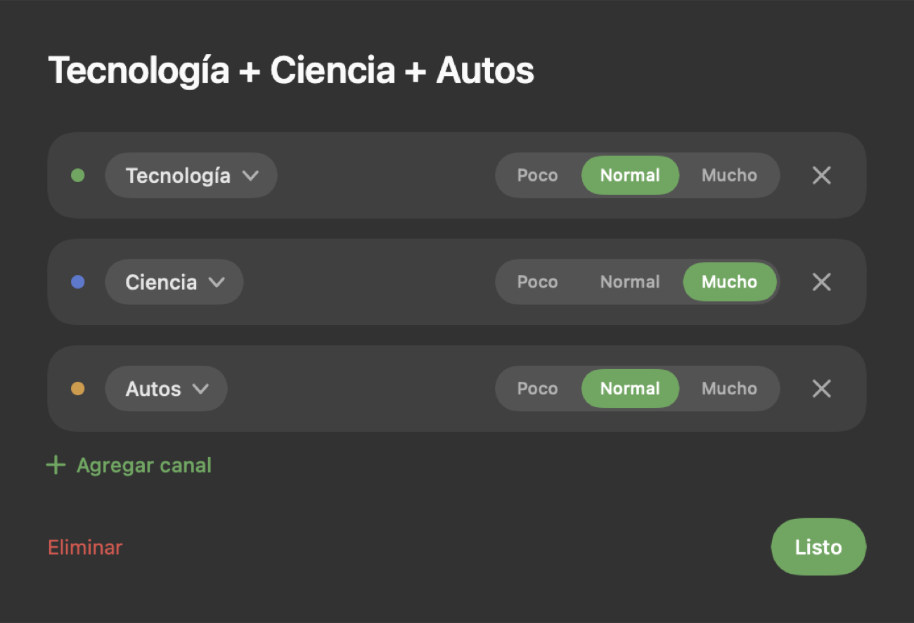

### Perfiles

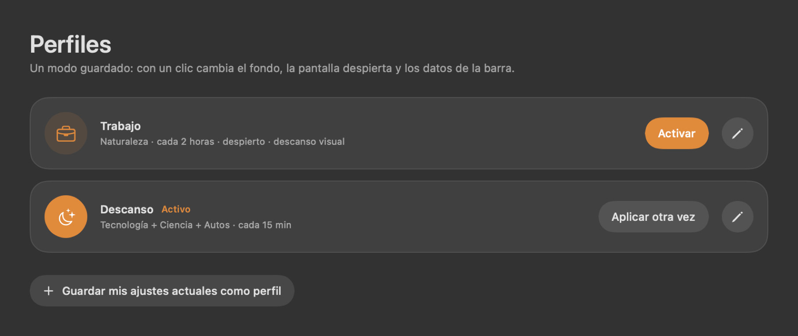

Un perfil es un **modo guardado**: con un clic cambia el canal de fondos, cada cuánto cambia, si el Mac se mantiene despierto, los datos de la barra de menú y el descanso visual. Vienen *Trabajo* y *Descanso*, y puedes crear los tuyos desde tus ajustes actuales. Un perfil también puede **activarse solo** a cierta hora de ciertos días.

### Sistema, internet y energía

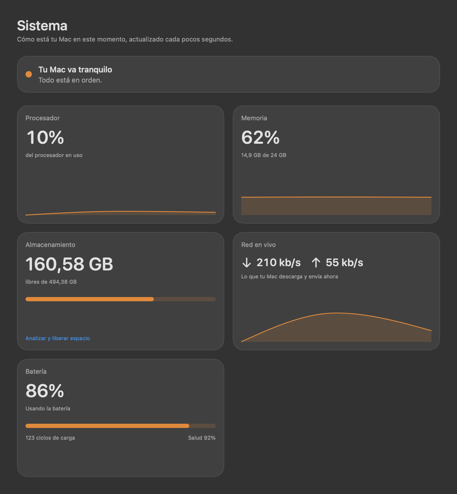

- **Sistema:** procesador, memoria, almacenamiento, red en vivo y batería (ciclos y salud), con gráficas y un resumen en lenguaje llano ("Tu Mac va tranquilo").
- **Internet:** mide tu conexión con la herramienta `networkQuality` de macOS, a mano o **automáticamente** cada 30 minutos a 1 día, y guarda un historial con gráfica.
- **Energía:** mantiene el Mac despierto durante 30 minutos a 8 horas, o sin límite.
- **Audio:** el volumen y la salida de tu Mac (bocinas, audífonos, AirPlay) a mano, con silencio y un volumen propio para Música y Spotify. macOS no deja cambiar el volumen de otras apps.

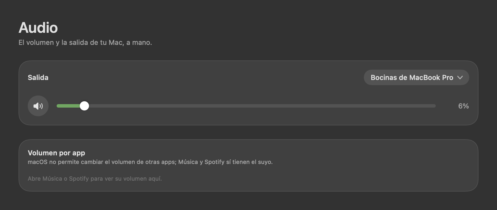

### Almacenamiento y limpieza

Encuentra qué ocupa espacio y lo libera **sin tocar tus documentos**.

- **Limpieza guiada** por categorías seguras: compilaciones de Xcode, símbolos de dispositivos iOS, cachés de apps, registros, Gradle, npm, cachés de herramientas y, marcadas como "Revisa antes", los archivos de Xcode y los emuladores de Android.
- **Simuladores de iOS:** quita los que ya no funcionan con tu Xcode.
- **Archivos grandes** (más de 300 MB) y un **explorador de carpetas** con barras de tamaño.
- **Aviso de poco espacio:** una notificación y una señal en el notch cuando el disco baja de un umbral que eliges (5 a 100 GB); no repite hasta que empeora o se recupera.
- **Seguro por diseño:** solo borra dentro de una lista blanca de carpetas conocidas, manda a la Papelera por defecto y pide confirmación siempre.

### Portapapeles con historial

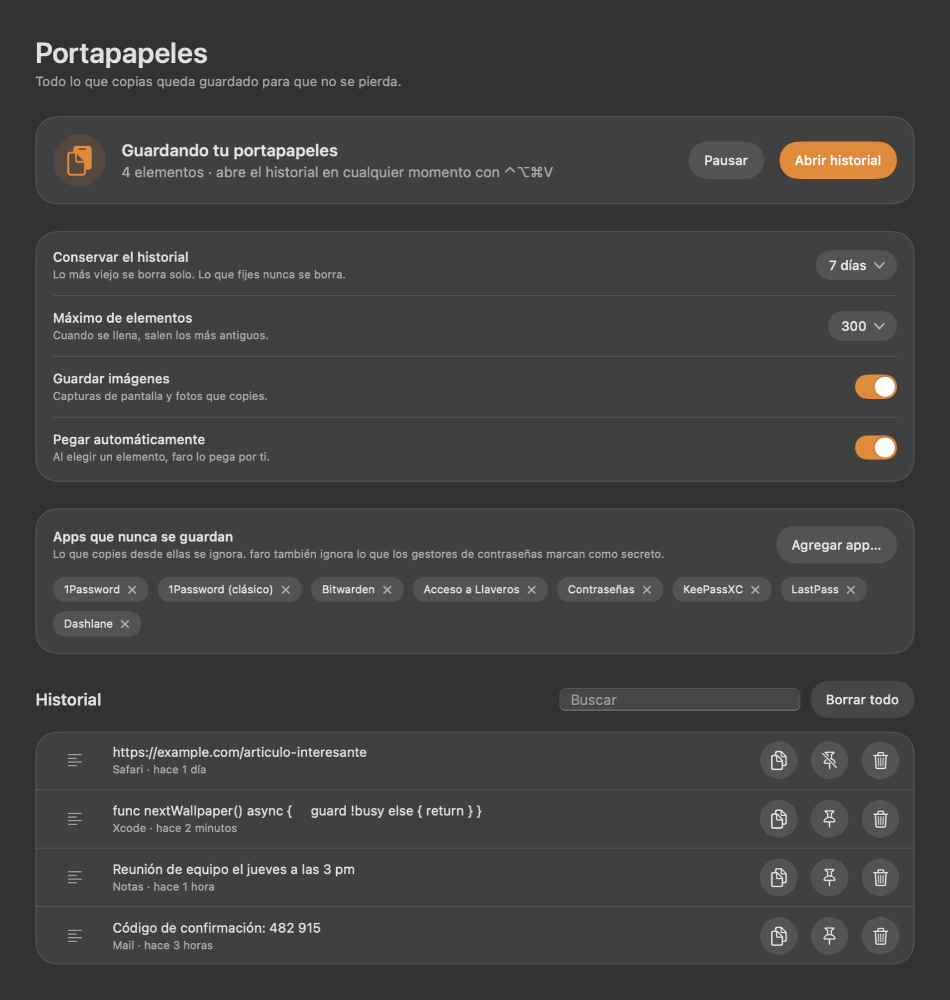

Nada se pierde: cada texto o imagen que copias queda guardado, con búsqueda y la opción de fijar lo importante.

- **Panel junto al cursor** con `⌃⌥⌘V`: escribe para buscar, `↑↓` para elegir y `↵` para pegar.
- **Privacidad primero:** ignora lo que los gestores de contraseñas marcan como secreto y lo que copies desde apps que excluyas (1Password, Bitwarden, Llaveros y otras vienen excluidas).
- **Se limpia solo:** conserva 24 horas, 7 o 30 días (o sin límite) y un máximo de elementos; lo fijado nunca se borra.
- **Pegado automático** opcional (necesita el permiso de Accesibilidad); sin él, el elemento se copia y pegas tú con `⌘V`.

### Bandeja de archivos

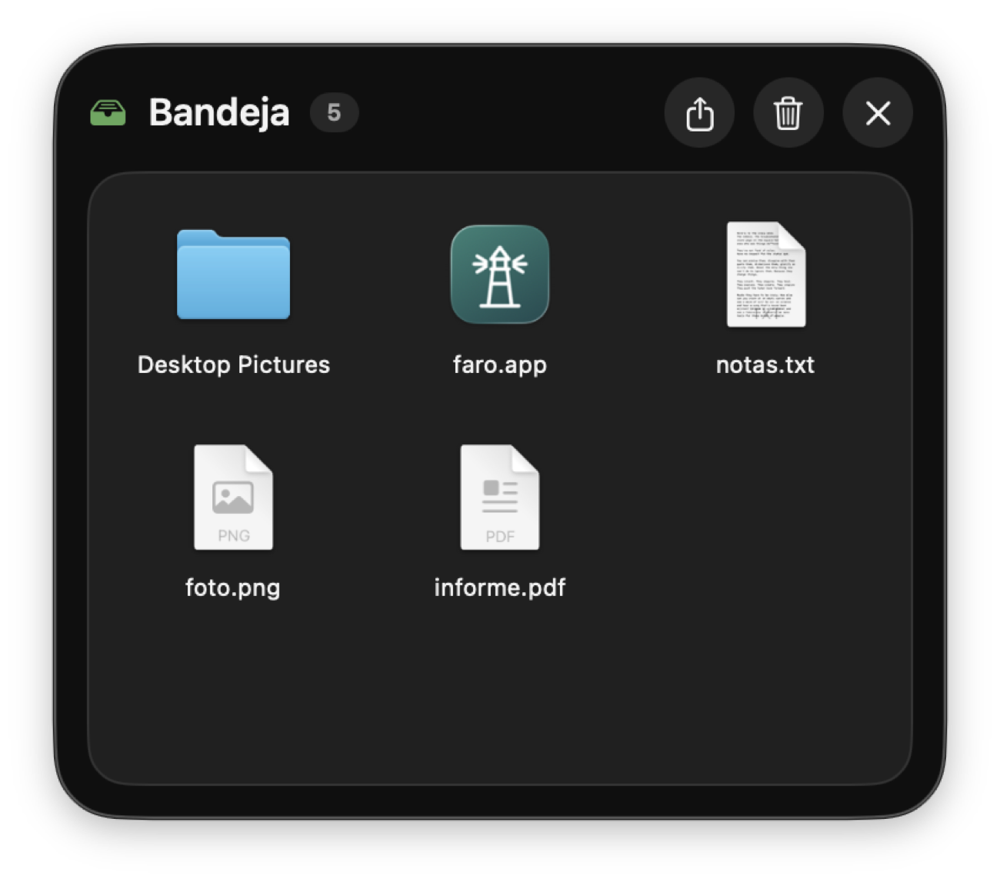

Un panel flotante para llevar archivos de una app a otra. Se abre con `⌃⌥⌘B`.

- **Arrastra dentro y fuera:** también puedes soltar archivos directamente sobre el ícono de faro en la barra de menú.
- **No gasta disco:** guarda referencias a los archivos, no copias.
- **AirDrop** de un archivo o de toda la bandeja, doble clic para abrir y clic derecho para mostrar en Finder.

### Limpiar teclado

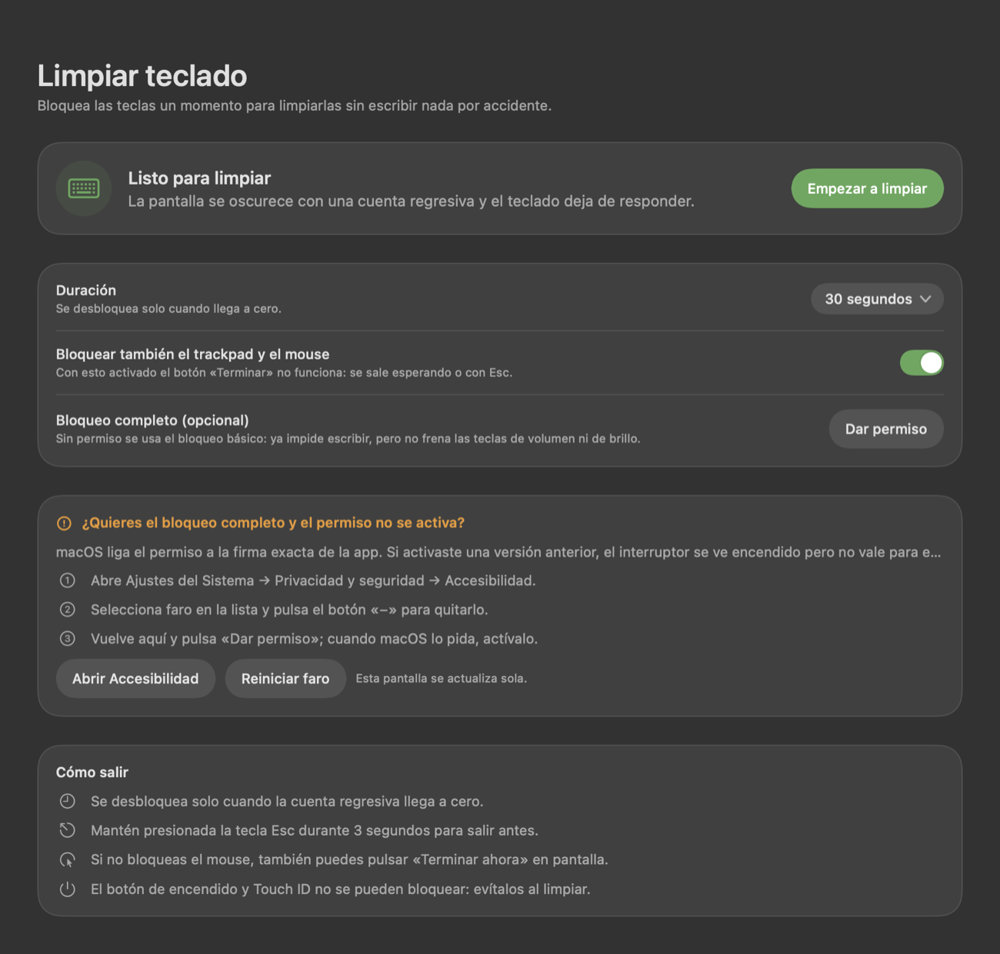

Bloquea las teclas un momento para limpiarlas sin escribir nada por accidente. La pantalla se oscurece con una cuenta regresiva.

- **Bloqueo básico, sin permisos:** faro ocupa la pantalla, se queda con el teclado, descarta todo lo que pulses e impide cambiar de app con `⌘Tab`.
- **Bloqueo completo (opcional):** con el permiso de Accesibilidad bloquea además volumen, brillo y los atajos del sistema.
- **Siempre se puede salir:** al llegar a cero, **manteniendo `Esc` 3 segundos**, o con el botón *Terminar ahora* si no bloqueaste el trackpad.

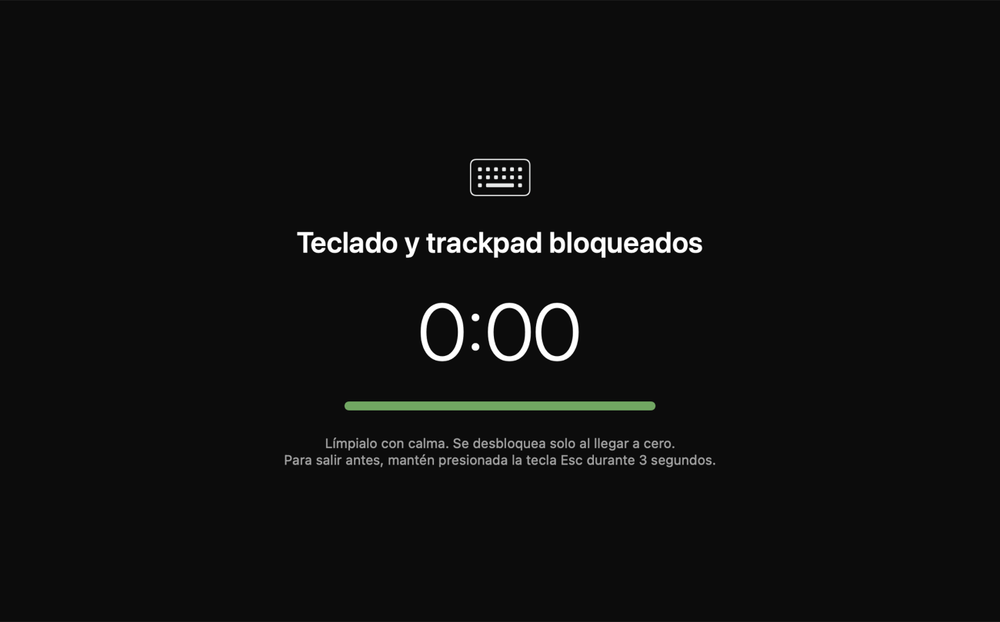

### Panel del notch

<p align="center">
  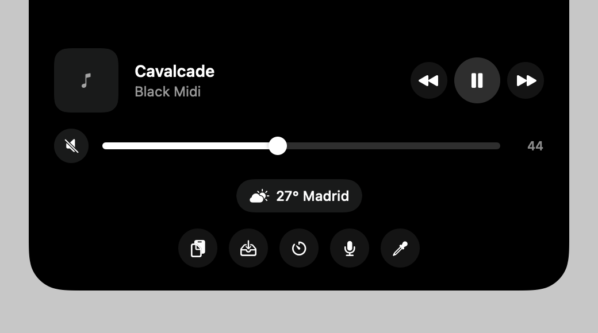
  
</p>

Un panel negro que cuelga del notch: lleva el cursor arriba al centro de la pantalla y se despliega. Mientras suena música o corre un descanso, aparecen detalles a los lados **sin desplegarlo**.

- **Música:** lo que suena en Música o Spotify, con carátula y controles.
- **Clima:** temperatura y estado del cielo de tu ciudad, con [Open-Meteo](https://open-meteo.com).
- **Calendario:** tu próximo evento de las siguientes 24 horas (apagado por defecto).
- **Descanso visual:** un aviso para mirar a lo lejos 20 segundos, la regla 20-20-20 (apagado por defecto).
- **Volumen:** un control del volumen de tu Mac dentro del panel.
- **Bluetooth:** un aviso al conectarse tus audífonos, teclado, ratón o mando.
- **Soltar archivos:** arrastra un archivo hacia el notch y suéltalo en la zona que aparece; se guarda en la bandeja.
- **Poco espacio en disco:** el notch muestra una señal ámbar cuando se acaba el espacio.

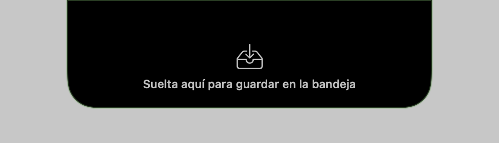

Sin notch, el panel aparece como una cápsula arriba al centro.

### Barra de menú y apariencia

- **Datos en vivo en la barra:** procesador, memoria, espacio libre, red, batería y velocidad de internet, a tu elección y con vista previa.
- **El faro se enciende:** el ícono de la barra, un faro dentro de un círculo, muestra los haces de luz cuando el Mac está en modo despierto.
- **Cristal líquido** en macOS 26 (con un material translúcido equivalente en versiones anteriores).
- **Idioma:** español, inglés o el del sistema (*General → Idioma*; faro se reinicia al cambiarlo).
- **Tus colores:** color de resalte (siete listos y uno libre), tinte del cristal del menú y color de fondo de la ventana.

## Requisitos

| | |
|---|---|
| **Sistema** | macOS 14 (Sonoma) o posterior. El cristal líquido y el panel del notch están pensados para macOS 26 en un MacBook con notch. |
| **Para compilar** | Xcode 26 o posterior (SDK de macOS 26) y Swift 5.9 o posterior. |
| **Probado en** | MacBook con Apple Silicon y macOS 26. |

## Instalación

Por ahora faro se **compila desde el código fuente**; todavía no hay binarios publicados.

```bash
git clone https://github.com/dpulr/faro.git
cd faro
./scripts/build-app.sh
```

El script compila en modo *release*, firma la app con la identidad de **Apple Development** que encuentre en tu llavero (así macOS conserva los permisos entre compilaciones; sin identidad, firma sin ella y los permisos se vuelven a pedir) e instala `faro.app` en `/Applications`.

Para que arranque con tu sesión, activa **Abrir al iniciar sesión** en la página *General*.

> **Primer arranque:** faro se abre con su ventana principal. Después vive en la barra de menú: el ícono del faro abre el menú (pulsar el logo dentro del menú expande la ventana), y soltar archivos sobre él los manda a la bandeja.
>
> **Cerrar con `⌘Q`:** faro pregunta antes de cerrarse, y ofrece minimizar solo la vista de escritorio para que siga en la barra de menú.

## Atajos de teclado

| Atajo | Acción |
|---|---|
| `⌃⌥⌘ →` | Siguiente foto |
| `⌃⌥⌘ ←` | Foto anterior |
| `⌃⌥⌘ H` | Ocultar esta foto para siempre |
| `⌃⌥⌘ S` | Guardar esta foto en `Imágenes/faro` |
| `⌃⌥⌘ V` | Historial del portapapeles |
| `⌃⌥⌘ B` | Bandeja de archivos |

Los atajos usan una API de macOS que **no requiere permisos especiales**.

## Permisos y privacidad

faro pide solo lo que cada función necesita, y cada permiso es **opcional**:

| Permiso | Para qué | Si no lo das |
|---|---|---|
| **Accesibilidad** | Bloqueo *completo* del teclado y pegado automático del portapapeles | El bloqueo básico sigue funcionando; el portapapeles solo copia |
| **Automatización: Finder** | Vaciar la Papelera desde la limpieza | Lo haces tú desde Finder |
| **Automatización: Música y Spotify** | Mostrar lo que suena en el notch | El notch no muestra música |
| **Calendarios** | Mostrar tu próximo evento en el notch | Ese módulo queda apagado |
| **Bluetooth** | Avisar en el notch cuando se conecta un dispositivo | Sin aviso de conexión |
| **Notificaciones** | El aviso de poco espacio en disco | Solo queda la señal en el notch |

### Qué sale de tu Mac

faro **no tiene telemetría ni cuentas**. Las únicas conexiones que hace son estas, y solo si usas la función:

| Servicio | Para qué | Qué se envía |
|---|---|---|
| `wallhaven.cc` | Buscar fotos | El tema que escribiste y la resolución mínima |
| `commons.wikimedia.org` y `upload.wikimedia.org` | Buscar y bajar fotos | El tema que escribiste |
| `www.bing.com` | Fotos del día | Nada personal |
| `open-meteo.com` | Clima | La ciudad que escribiste |
| Servidores de Apple (`networkQuality`) | Medir la conexión | Lo normal de una prueba de velocidad |
| `api.artic.edu` y `www.artic.edu` | Obras del Art Institute of Chicago | El tema que escribiste |
| `images-api.nasa.gov` y `images-assets.nasa.gov` | Imágenes de la NASA | El tema que escribiste |
| `picsum.photos` | Fotos al azar | Nada personal |
| `i.scdn.co` | Carátula de Spotify | Solo mientras suena algo de Spotify |

Todo lo demás —historial del portapapeles, bandeja, ajustes, fotos— **se queda en tu disco**. El portapapeles no guarda lo que los gestores de contraseñas marcan como secreto. Para borrarlo todo, quita la carpeta de datos (abajo).

## Fuentes de fotos y atribuciones

faro **no redistribuye imágenes**: las descarga de cada fuente para mostrarlas en tu escritorio, con el título y el autor a la vista. Cada foto tiene su propia licencia, y las de Wikimedia Commons suelen exigir atribución: por eso faro muestra el nombre del autor junto a la imagen. Las fotos que guardas con el botón de guardar son para tu uso personal; respeta la licencia de cada una si las compartes.

## Dónde guarda cada cosa

| Qué | Dónde |
|---|---|
| Ajustes, canales, perfiles e historial de fotos | `~/Library/Application Support/faro/state.json` |
| Portapapeles (texto e imágenes) | `~/Library/Application Support/faro/clipboard.json` y `clips/` |
| Bandeja y mediciones de internet | `shelf.json` y `speed.json` (misma carpeta) |
| Foto actual de cada monitor | `~/Library/Caches/faro/current/` |
| Fotos que guardas con el botón de guardar | `~/Pictures/faro/` |
| Apariencia, notch y limpieza de teclado | Preferencias de la app (`defaults read co.soyholistico.faro`) |

## Desarrollo

```
Sources/faro/
├── main.swift, AppDelegate.swift   Arranque (AppKit puro) y menú principal
├── Core/                           Motor de fondos, modelos, persistencia, AppController
├── Sources/                        Fuentes de fotos (Wallhaven, Wikimedia, Bing, Art Institute, NASA, Picsum, carpeta)
├── Modules/                        Monitor del sistema, internet, despierto, audio, aviso de disco
├── Storage/                        Limpieza y análisis de disco
├── Clipboard/  Shelf/  Cleaning/   Portapapeles, bandeja y limpiar teclado
├── Notch/                          Modelo, vista y controlador del panel del notch
└── UI/                             Páginas, menú, tema, controles propios y `tr()` (idioma)
Resources/                          Traducciones (`es.lproj`, `en.lproj`), generadas desde `scripts/en.txt`
```

La arquitectura, con los porqués de cada decisión, está en [`docs/ARQUITECTURA.md`](docs/ARQUITECTURA.md).

### Herramientas de prueba

faro trae modos de prueba, activados con variables de entorno, que no cambian nada en uso normal:

| Variable | Qué hace |
|---|---|
| `python3 scripts/gen-strings.py` | Genera `Resources/en.lproj/Localizable.strings` desde `scripts/en.txt` (líneas `español => english`) |
| `python3 scripts/make-logo.py` | Regenera el logo (`docs/images/logo.svg`, `logo-mark.svg`) y el código Swift que lo dibuja |
| `FARO_SELFTEST=1 .build/release/faro` | Cambia el fondo 8 veces e imprime la fuente de cada foto y el tamaño de la caché |
| `FARO_SNAPSHOT=<carpeta>` | Dibuja cada pantalla a PNG sin abrir la app |
| `open --env FARO_DEBUG_SHOT=<carpeta> --stdout <archivo> -n /Applications/faro.app` | Abre menú, bandeja y notch de verdad, ejecuta pruebas y captura las ventanas |
| `open --env FARO_DEBUG_PERMS=<archivo> -n /Applications/faro.app` | Escribe qué permisos ve la app y prueba el bloqueo de teclado |

### Convenciones de diseño

- Sin tipografía con serifa y sin controles genéricos del sistema: usa los de [`UI/Controls.swift`](Sources/faro/UI/Controls.swift).
- Botones redondos **sin texto**, con ayuda instantánea (`.instantTip`).
- Todo el texto en español y en lenguaje llano.
- Cada archivo de código lleva el encabezado de licencia SPDX.

## Preguntas frecuentes

**¿Por qué pide el permiso de Accesibilidad?**
Solo para el bloqueo *completo* del teclado y para pegar automáticamente desde el historial. Nada más lo usa, y se puede negar sin perder ninguna otra función.

**¿Borra algo de mi disco sin avisar?**
No. La limpieza solo actúa sobre lo que marcas, dentro de una lista blanca de carpetas conocidas, manda a la Papelera por defecto y siempre pide confirmación.

**¿Por qué no está en la App Store?**
Funciones como el bloqueo de teclado, el panel del notch y la lectura de Música o Spotify no son compatibles con el entorno restringido de la App Store.

**¿Funciona sin notch?**
Sí. El panel aparece como una cápsula arriba al centro de la pantalla.

**¿Por qué se llama faro?**
Por la idea de una luz que te muestra lo importante desde lejos.

## Hoja de ruta

Ideas que no están hechas todavía, sin fechas:

- Volumen por aplicación para cualquier app (macOS no lo permite sin un controlador de audio propio).
- Más idiomas.
- Integración continua y binarios firmados y notarizados.

Las propuestas y los fallos se reportan en [Issues](https://github.com/dpulr/faro/issues).

## Contribuir, seguridad y conducta

- **Contribuir:** lee [`CONTRIBUTING.md`](CONTRIBUTING.md).
- **Reportar una vulnerabilidad:** sigue [`SECURITY.md`](SECURITY.md); no abras un issue público.
- **Convivencia:** este proyecto sigue un [código de conducta](CODE_OF_CONDUCT.md).

## Licencia

faro es **software libre** bajo la licencia **GNU Affero General Public License, versión 3 o posterior** (AGPL-3.0-or-later). El texto completo está en [`LICENSE`](LICENSE).

En palabras llanas, y sin ser asesoría legal: puedes usarlo, estudiarlo, modificarlo y compartirlo. Si distribuyes una versión modificada —o la ofreces a otras personas a través de una red— debes publicar su código fuente bajo esta misma licencia. El programa se ofrece **sin ninguna garantía**.

Copyright © 2026 Daniel Pulgarín.

## Agradecimientos

faro es un proyecto independiente. **No tiene relación** con Apple, Spotify, FARO Technologies, Wallhaven, Wikimedia, Microsoft ni con ninguna de las apps mencionadas; los nombres pertenecen a sus dueños.

Inspiración (ideas, no código): **Irvue** (fondos por canales), **Sapphire** (el notch como espacio útil) y **CopyClip** (historial del portapapeles). Los datos, las fuentes y las licencias de terceros están en [`CREDITS.md`](CREDITS.md).
